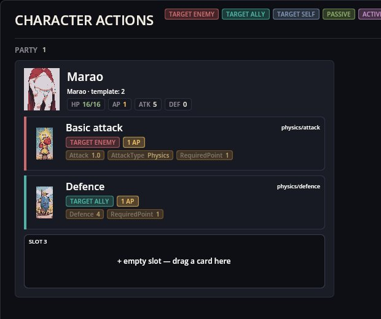
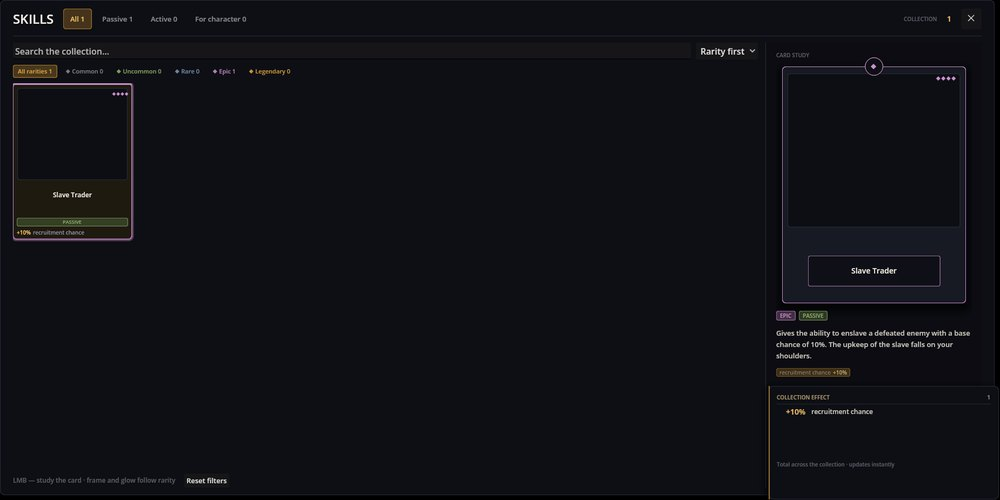

# Cthangover: Starter Party — 플레이어의 시작 멤버

이 작은 모드는 Cthangover 새 게임의 시작 상태를 만들어 줍니다: 파티에 들어간 마라오, 그리고 스킬 컬렉션의 ‘노예 상인’. 여기에는 이 코드만 들어 있고, 캐릭터와 스킬 자체는 기본 게임과 스킬 엔진의 데이터입니다.

## 새 플레이어가 가진 것

Cthangover 맨 처음의 캐릭터 패널 — 파티 멤버는 마라오 한 명, 행동 두 개와 빈 슬롯 하나:

스킬 패널 — 스킬은 하나, 노예 상인:

노예 상인이 있어야 플레이어가 쓰러뜨린 적을 포획할 수 있습니다(Recruiting 참조): 이 스킬이 없으면 그 누구도 파티에 합류하지 못합니다.

## 언제 작동하나

- 게임의 모드가 준비되면 이 모드는 캐릭터 `Marao`를 파티에 추가하고 스킬 `slave_master`를 부여합니다.
- **새 게임**이 시작될 때마다 같은 일을 다시 합니다. 새 게임은 먼저 파티를 비우기 때문입니다.
- 저장 파일을 불러오면 파티와 스킬이 저장된 것으로 교체됩니다. 두 단계는 여러 번 실행되어도 안전합니다: 마라오가 두 번 추가되거나 스킬이 두 번 부여되지 않습니다.

## 시작을 바꾸려면

- 다른 모드도 같은 방식으로 시작 캐릭터를 더 추가할 수 있습니다: 모드가 준비되면 자기 캐릭터를 파티에 넣는 C# 초기화기입니다.
- 마라오나 스킬 없이 시작하려면 이 모드를 게임의 컬렉션에서 빼고, 자기 모드에서 파티를 꾸리세요.

## 알려진 문제

- 노예 상인 카드에 그림이 없습니다: 스킬 이미지가 빠져 있습니다.
- 카드와 설명은 “영입 확률 +10%”를 약속하지만, 이 보너스를 읽는 코드는 없습니다. 포획 판정은 오직 적 자신의 확률만 사용합니다.
